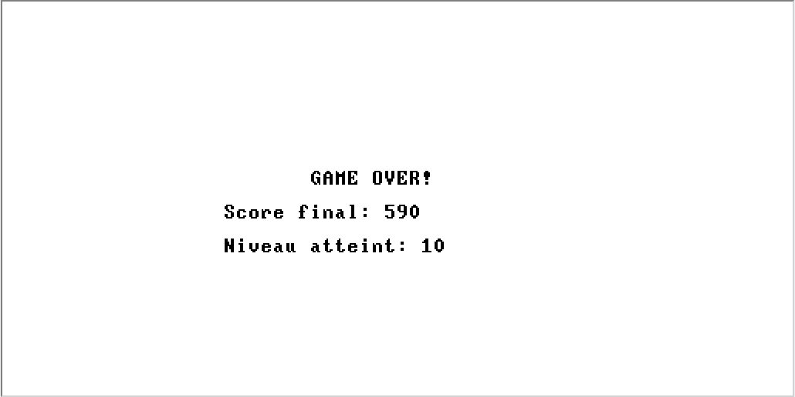

# Système mono-tâche — compilateur Jack et Snake

Projet de **L2 Informatique, semestre 3**, réalisé dans le cadre du cours **Système mono-tâche** à l’Université d’Orléans.

Le but est de comprendre comment un programme passe d’un langage de haut niveau à des instructions exécutables par une machine. Le projet suit l’architecture Jack / VM / Hack utilisée dans le cours, à partir de nand2tetris. Le Snake sert de démonstration.

## Travail réalisé

Deux outils en Python composent la chaîne :

1. **Jack → VM** : analyse lexicale, analyse syntaxique, table des symboles et génération du code intermédiaire.
2. **VM → assembleur Hack** : opérations sur la pile, accès aux segments mémoire, branchements et appels de fonctions.

Le jeu est écrit en Jack. Il utilise les services de l’OS Jack pour le clavier, l’écran, la mémoire et la temporisation.

## Organisation

```text
src/
  jack/             Compilateur Jack → VM
  vm_translator/    Traducteur VM → assembleur Hack
examples/
  snake/            Sources Jack et fichiers VM du Snake
  pong/jack/        Autre exemple de jeu en Jack
docs/images/        Capture du Snake
archives/
  asm/              Sorties assembleur et essais
  vm/               Anciennes sorties VM
  snake-variant/    Autre version conservée du Snake
```

Les anciennes variantes sont conservées dans `archives/`. Le dossier de travail pour compiler est `build/`, ignoré par Git.

## Compiler

Avec Python 3.10 ou plus récent, depuis la racine du dépôt :

```sh
mkdir -p build
cd build
python3 ../src/jack/Translator.py ../examples/snake
cp ../examples/snake/Sys.vm .
python3 ../src/vm_translator/Translator.py . Snake.asm
```

Le compilateur écrit les fichiers VM dans le dossier courant. Le traducteur les regroupe ensuite dans `Snake.asm`.

## Jouer au Snake

Charger les fichiers de `examples/snake/` dans le VM Emulator de nand2tetris, avec les services intégrés de l’OS disponibles.

- **Flèches** : diriger le serpent.
- **Espace** : passer au niveau suivant lorsqu’il est terminé.
- **Échap** : quitter la partie.

Le jeu prévoit dix niveaux de difficulté.



## Ce que le projet met en pratique

Le lien entre langage source, pile d’exécution et mémoire est le point central du cours : analyser une expression Jack, produire les instructions VM correspondantes, puis traduire ces instructions pour l’architecture Hack.

La génération de l’assembleur a été vérifiée. L’OS Jack n’est pas inclus dans cette sortie : elle ne constitue pas, à elle seule, un jeu autonome pour le CPU Emulator. Les fichiers d’essai archivés ne sont pas une suite de tests automatisés.

Projet universitaire collectif. Ce dépôt présente la version conservée par Hassan Slimani.

## Autres projets universitaires

- [POO — Morpion, Puissance 4 et Nim](https://github.com/hslimani45/Morpion-puissance4)
- [Framework Web 1 — Bonnes Lectures](https://github.com/hslimani45/bonnes-lectures)
